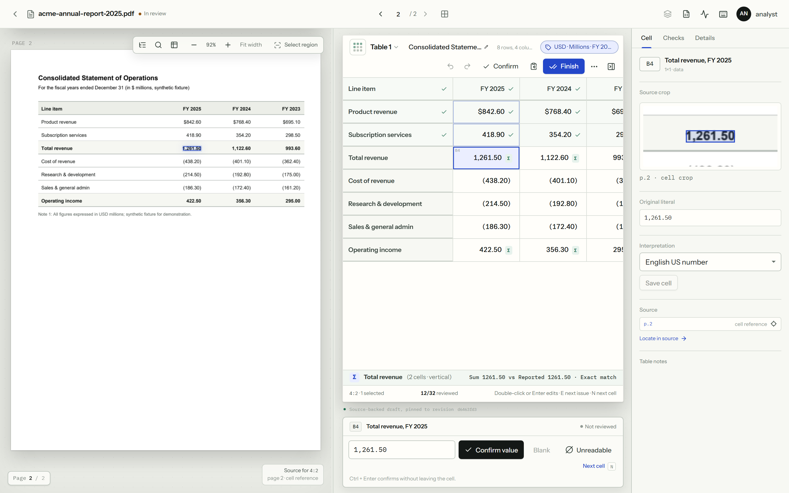

# Table Review

[](https://github.com/Venkateswara-Sahu/table-review/actions/workflows/ci.yml)
[](LICENSE)

**A local-first financial PDF-to-Excel workbench for extracting, verifying, and exporting source-backed tables.**

Table Review places a spreadsheet-grade review grid beside the original PDF page, links every cell back to its PDF coordinates, automatically detects financial subtotals and cross-footing checks, and exports audit-ready Excel workbooks with live `=SUM(...)` formulas, currency formatting, and deterministic revision checksums.

<picture>
  <source media="(prefers-color-scheme: dark)" srcset="docs/assets/review-screen-dark.png" />
  <source media="(prefers-color-scheme: light)" srcset="docs/assets/review-screen.png" />
  
</picture>

*Synthetic fixture shown. Built for private, local financial documents.*

## Key capabilities

- **Instant PDF discovery (zero ML startup):** Browse the document table of contents (`outline`), run full-text `Ctrl / ⌘ + F` search with PDF page bounding-box highlights, and scan candidate table regions across up to 500 pages before launching any extraction job.
- **Hybrid extraction engine (`1–20` pages per run):**
  - `native_fast`: ~15 ms/page zero-ML extractor for digital vector/text PDFs with cell bounding boxes and table captions — works immediately without downloading large ML model weights.
  - `docling`: Warm persistent worker running Docling + RapidOCR with CPU/GPU auto-detection (`auto`, `cpu`, `cuda`, `mps`) and `accurate` / `fast` TableFormer modes for scanned or complex tables.
  - `vlm`: Opt-in OpenAI-compatible Vision-Language adapter (for local Ollama or BYOK endpoints) grounded to PDF tokens; disabled by default in strict offline `hosted` mode.
  - `auto`: Routes digital pages through fast native extraction and falls back cleanly when ML/OCR is needed.
- **Multi-page table stitching:** Combine continuation pages into a single unified table while stripping repeated headers and preserving each cell's original page number and PDF bounding box.
- **Spreadsheet-grade review desk:**
  - Drag-resizable split pane (`localStorage` persisted) with a collapsible Inspector Rail and a live 2× DPR **Source Cell Loupe** cropping the active PDF cell.
  - Semantic sticky-header / sticky-row-label spreadsheet grid with range selection, IME-safe inline cell editing, and full revision **Undo / Redo** history (`Ctrl+Z` / `Ctrl+Shift+Z`).
  - Financial parsing for `$`, `€`, `£`, `₹`, `¥`, ISO currency codes, accounting negatives `(1,234.50)`, European (`1.234,56`) and Indian (`12,34,567.89`) number formats, and dash-zero (`-`).
  - Automatic vertical, grand-total, and horizontal cross-footing subtotal detection with inline badge verification (`Σ`, `Σ≈`, `Σ!`) alongside custom manual subtotals.
  - **Exception-first review (`standard` mode by default):** Bulk-confirm clean cells (`clean_all`, `row`, or `column`) and jump directly to remaining exceptions (`E`), or switch to `strict_audit` for 100% cell-by-cell sign-off.
- **Analyst-ready exports & clipboard:** Export single tables (`.xlsx` or `.csv`) or bundle selected tables across an entire PDF into a multi-sheet **Report Workbook** (`.xlsx`) with live Excel `=SUM(...)` formulas, `$#,##0.00` number formatting, source references, and deterministic ZIP/SHA-256 provenance — or copy TSV / Markdown / JSON directly from the toolbar.
- **Zero-friction local setup & strict security boundaries:** Browser-based loopback-only first-run account creation (permanently locked once any account exists and completely disabled in `hosted` mode), opt-in local document retention (reports stay indefinitely until deleted locally; 30-day default in `hosted`), Argon2id passwords, CSRF/Origin enforcement, and encrypted backups.

## Stack

| Layer | Technology |
|---|---|
| API & Domain | Python 3.12, FastAPI, Pydantic v2, SQLAlchemy 2, Alembic, PostgreSQL |
| PDF & Extraction | pypdfium2, pypdf, custom `native_fast` extractor, Docling + RapidOCR warm persistent worker, optional OpenAI-compatible VLM adapter |
| Web UI | React 19, TypeScript, Vite, TanStack Query, Radix UI, Lucide icons |
| Export & Security | openpyxl, Argon2id, Cryptography (Fernet), SQLite immutable lifecycle journal |
| Tests & Infra | pytest, Playwright, Ruff, Docker Compose, optional Caddy HTTPS |

## 60-second quick start

Prerequisites: Python 3.12, [uv](https://docs.astral.sh/uv/), Docker (Engine or Desktop), and Node 24+ (for building or running the React UI).

### Option A: Fast local workbench (starts immediately, no 2 GB model download required)

```powershell
git clone https://github.com/Venkateswara-Sahu/table-review.git
cd table-review
uv sync --frozen --group dev
cd web && npm ci && cd ..
```

Start PostgreSQL, database migrations, the warm worker, and the loopback web UI with one command:

```powershell
# Windows PowerShell
.\scripts\start-local.ps1 --open
```

```bash
# macOS / Linux
./scripts/start-local.sh --open
```

Want scanned PDF / OCR extraction with Docling weights too? Pass `--with-docling`:

```powershell
uv sync --frozen --extra extraction --group dev
.\scripts\start-local.ps1 --with-docling --open
```

Open <http://127.0.0.1:8000> (if `--open` was omitted). On first run from loopback, the sign-in page shows a **Create your local workspace** form to create your account directly in the browser. Stop cleanly with `Ctrl+C`, and stop the background Postgres container (preserving all data volumes) with `--stop`.

### Option B: Hardened Docker Compose stack (offline network-isolated worker)

```powershell
uv sync --frozen --extra extraction --group dev
uv run --frozen python scripts/deploy_local.py --preload
```

Open <http://127.0.0.1:8000> from the host to create your local workspace on first run, or manage additional local accounts with `python -m table_review.accounts.admin create|reset|revoke <username>`. See [docs/local-deployment.md](docs/local-deployment.md) and [docs/data-and-backups.md](docs/data-and-backups.md) for full operational details.

## Configuration

Copy `.env.example` to `.env` for local overrides (`.cache/dev.env` and `.cache/local.env` store auto-generated local database secrets; never commit them).

| Variable | Purpose | Default (`local` / `hosted`) |
|---|---|---|
| `TABLE_REVIEW_DEPLOYMENT_MODE` | Security & onboarding mode (`local` \| `hosted`) | `local` |
| `TABLE_REVIEW_RETENTION_DAYS` | Days of inactivity before auto-expiry, or `none`/`0` to keep forever | `none` (`local`) / `30` (`hosted`) |
| `TABLE_REVIEW_EXTRACTION_BACKEND` | Default extraction backend (`auto` \| `native_fast` \| `docling` \| `vlm`) | `auto` |
| `TABLE_REVIEW_EXTRACTION_DEVICE` | ML compute target (`auto` \| `cpu` \| `cuda` \| `mps`) | `auto` |
| `TABLE_REVIEW_VLM_BASE_URL` | Optional OpenAI-compatible VLM endpoint (e.g. Ollama `http://127.0.0.1:11434/v1`) | Unset |
| `TABLE_REVIEW_VLM_MODEL` | Model name for `vlm` backend | Unset |
| `TABLE_REVIEW_VLM_API_KEY` | Optional bearer token for BYOK VLM endpoints | Unset |
| `TABLE_REVIEW_ALLOW_VLM_IN_HOSTED` | Allow external VLM calls in strict offline `hosted` mode | `false` |
| `TABLE_REVIEW_PORT` / `TABLE_REVIEW_PUBLIC_ORIGIN` | HTTP port & exact CSRF origin URL | `8000` / `http://127.0.0.1:8000` |
| `TABLE_REVIEW_SECURE_COOKIES` | Enforce `Secure` attribute on session/CSRF cookies (`true` required in `hosted`) | `false` (Docker local) / `true` |

## Keyboard shortcuts

| Shortcut | Action |
|---|---|
| `Arrow keys` | Move between grid cells |
| `Shift + arrow / click` | Select a rectangular cell range |
| `Double-click` / `Enter` / `F2` | Edit the active cell inline |
| `Tab` / `Shift + Tab` | Save inline edit & move to next / previous cell |
| `Ctrl / ⌘ + Enter` | Confirm cell verdict (saves inline edit first) |
| `Escape` | Discard / cancel active inline edit |
| `Ctrl / ⌘ + Z` / `Ctrl / ⌘ + Shift + Z` | Undo / redo table revision |
| `E` | Jump to next open exception |
| `N` | Jump to next unchecked cell |
| `Ctrl / ⌘ + F` | Find text across PDF pages with bounding-box highlights |
| `Page Up` / `Page Down` | Scroll the PDF source pane |
| `?` | Open the in-app shortcuts dialog |

## Testing

```powershell
# Domain unit tests (no Postgres required; ~400 fast tests)
uv run --frozen --group dev pytest tests/domain -m "not extraction" -q

# Integration & acceptance tests (requires PostgreSQL; Docker tests require runtime fixture)
uv run --frozen --group dev pytest tests/integration -q
uv run --frozen --group dev pytest tests/acceptance -m "not packaged" -q

# Lint & frontend checks
uv run --frozen --group dev ruff check src evaluation tests scripts
cd web
npm run typecheck
npm run build
npm run format:check
npm run test:e2e
```

## Evaluation

`evaluation/` records frozen extraction and check benchmarks, including strict literal, placement, association, and geometry scores. Source PDFs and crops are not redistributed. Read [evaluation/README.md](evaluation/README.md) for the benchmark protocol, files, and limitations.

## Limits

- Complex multi-line financial headers or degraded scans still require human inspection against the source loupe and PDF highlight.
- `native_fast` targets born-digital vector/text PDFs; scanned image PDFs require `docling` (with preloaded OCR models) or a configured `vlm` backend.
- Each extraction job selects 1 to 20 pages; larger multi-page statements can be extracted in batches and stitched cleanly with **Stitch tables**.
- No independent hosted SLA is claimed; review every flagged exception before external distribution.

## Project layout

```text
src/table_review/   API, domain services, financial normalization, extraction backends & exporters
web/                React 19 / TypeScript spreadsheet desk & PDF discovery UI
infra/              Docker Compose, Dockerfiles, Caddy HTTPS proxy & model manifests
migrations/         Alembic PostgreSQL schema migrations
scripts/            One-command local launcher, Docker deployment & OpenAPI/schema tools
tests/              Domain, integration & acceptance test suites
evaluation/         Frozen extraction benchmark harness and scores
docs/               Deployment, backup/restore & OpenAPI contract docs
```

## API

The OpenAPI contract is checked into [docs/api/openapi.json](docs/api/openapi.json), and frontend types in `web/src/api/types.ts` are generated directly from it (`scripts/generate_api_schema.py` + `npm run generate:types`).

## Security and privacy

- **Local-first by default:** All uploads, renders, journals, and backups stay on your machine under owner-scoped storage (`PrivateBlobStore` + PostgreSQL row ownership checks returning uniform `404` on foreign resources).
- **One-time loopback onboarding:** `POST /api/v1/setup` and `GET /api/v1/setup/status` refuse proxied headers (`X-Forwarded-For`, `Forwarded`, `X-Real-IP`), require `deployment_mode == "local"`, enforce exact `Origin` verification, require a direct loopback client, and permanently lock after the first account exists using `pg_advisory_xact_lock`. In `hosted` mode, local onboarding is completely disabled and non-disclosing.
- **Container hardening:** The Docker worker runs with read-only root filesystem, dropped Linux capabilities, `no-new-privileges`, a 6 GiB memory limit, and `network_mode: none`.
- Report vulnerabilities privately via the repository's Security tab; see [SECURITY.md](SECURITY.md).

## Contributing & License

Issues and pull requests are welcome. See [CONTRIBUTING.md](CONTRIBUTING.md) and [CODE_OF_CONDUCT.md](CODE_OF_CONDUCT.md). Released under the [MIT License](LICENSE).
