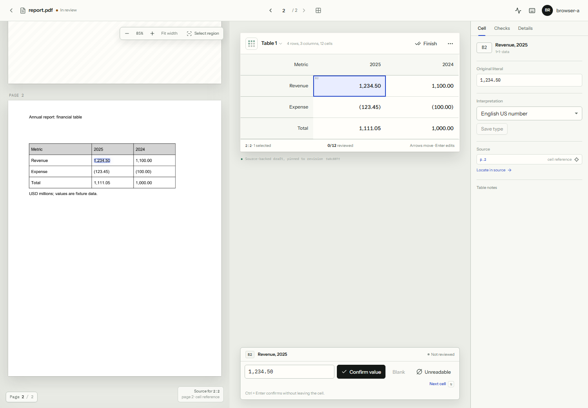

# Table Review

[](https://github.com/Venkateswara-Sahu/table-review/actions/workflows/ci.yml)
[](LICENSE)

**A local-first review desk for turning annual-report PDF tables into source-backed spreadsheets.**

Table Review extracts tables from digital or scanned PDF pages, places the extracted grid beside the original page, and lets a reviewer correct values, record decisions and export the exact revision they approved. It runs on CPU, on your machine, with PostgreSQL, FastAPI and a separately bounded Docling worker.



*Synthetic fixture shown. The application is designed for private, local documents.*

## What it does

- Upload a PDF (up to 50 MiB / 500 pages) and select one to five pages, or a region for OCR.
- Extract native or image-based tables with Docling; build an explicit manual grid when detection misses a table.
- Compare every cell with a highlighted, zoomable source page.
- Edit values, record explicit blanks and unreadable cells, and add source context: period, currency, scale and measure.
- Declare subtotals, run consistency checks and keep an immutable review timeline.
- Export XLSX or CSV with source references, review state and a revision checksum.
- Use private accounts, owner checks, retention, deletion and encrypted recovery.

## Stack

| Layer | Technology |
|---|---|
| API | Python 3.12, FastAPI, SQLAlchemy, Alembic, PostgreSQL |
| Extraction | Docling, ONNX Runtime and RapidOCR on CPU, in an isolated Docker worker |
| Web | React 19, TypeScript, Vite |
| Tests | pytest, Playwright |
| Deployment | Docker Compose; optional Caddy HTTPS |

## Quick start

Prerequisites: Python 3.12, [uv](https://docs.astral.sh/uv/) and Docker with at least 8 GiB available RAM. Node 24 is only needed for frontend development.

```powershell
git clone https://github.com/Venkateswara-Sahu/table-review.git
cd table-review
uv sync --frozen --extra extraction --group dev
uv run --frozen --extra extraction python scripts/preload_models.py
uv run --frozen --extra extraction python scripts/preload_ocr_models.py
uv run --frozen python scripts/deploy_local.py
```

Open <http://127.0.0.1:8000>. Create the first account from the host:

```powershell
docker compose --env-file .cache/local.env -p table-review-local -f infra/compose.yaml exec api python -m table_review.accounts.admin create your-username
```

The full setup, configuration, stop/start and troubleshooting guide is in [docs/local-deployment.md](docs/local-deployment.md). Data retention and backup instructions are in [docs/data-and-backups.md](docs/data-and-backups.md).

## Configuration

Copy `.env.example` to `.env` for local overrides. The deployment generates its database password into ignored `.cache/local.env`; never commit either file. The main settings are `POSTGRES_PASSWORD`, `TABLE_REVIEW_MODELS`, `TABLE_REVIEW_PORT`, `TABLE_REVIEW_PUBLIC_ORIGIN` and `TABLE_REVIEW_SECURE_COOKIES`.

## Testing

```powershell
uv run --frozen --group dev pytest tests/domain tests/integration -q
uv run --frozen --group dev pytest tests/acceptance -m "not packaged" -q
cd web
npm ci
npm run build
npm run test:e2e
```

Integration tests use PostgreSQL; extraction tests require the preloaded models. The acceptance suite can start an isolated deployment; see [docs/local-deployment.md](docs/local-deployment.md).

## Evaluation

`evaluation/` records frozen extraction and check benchmarks, including strict literal, placement, association and geometry scores. The source PDFs and crops are not redistributed. Read [evaluation/README.md](evaluation/README.md) for the protocol, files and limitations.

## Limits

- Automatic extraction is unreliable on some layouts; every figure needs review against the source image.
- OCR is fallible and financial units are not attached automatically.
- CPU-only extraction runs one job at a time; each run selects one to five pages.
- The evaluation is not an independent human gold standard, and no time-savings or hosted-reliability claim is made.
- This is an early-stage local-first tool, not a hosted SaaS and not production-certified.

## Project layout

```text
src/table_review/   API, domain services and extraction adapters
web/                React/TypeScript review UI
infra/              Docker Compose, Dockerfiles and optional Caddy proxy
migrations/         Alembic migrations
tests/              Domain, integration and acceptance tests
evaluation/         Frozen benchmark results and protocol
docs/               Local deployment, data/backup guide and API schema
```

## API

The OpenAPI schema is recorded at [docs/api/openapi.json](docs/api/openapi.json). The web client types are generated from it.

## Contributing

Issues and pull requests are welcome. For substantial changes, open an issue first so the approach can be discussed. Run the test commands above before opening a pull request.

## Security and privacy

Table Review is designed for loopback or private-network use. Do not expose it directly to the internet without HTTPS, secure cookies, a reverse proxy and independent backups. There is no public signup route; accounts are created from the host. Report vulnerabilities privately from the repository's Security tab, not in a public issue. See [SECURITY.md](SECURITY.md).

## License

MIT. See [LICENSE](LICENSE).

## Acknowledgements

Built on Docling, RapidOCR, FastAPI, React and the other open-source packages pinned in `pyproject.toml` and `web/package.json`.
